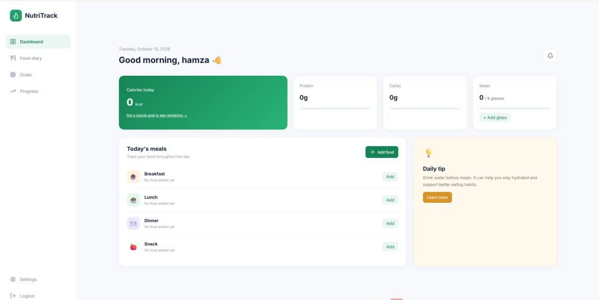
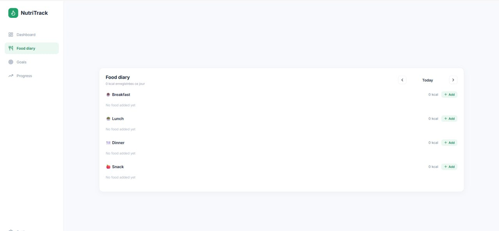
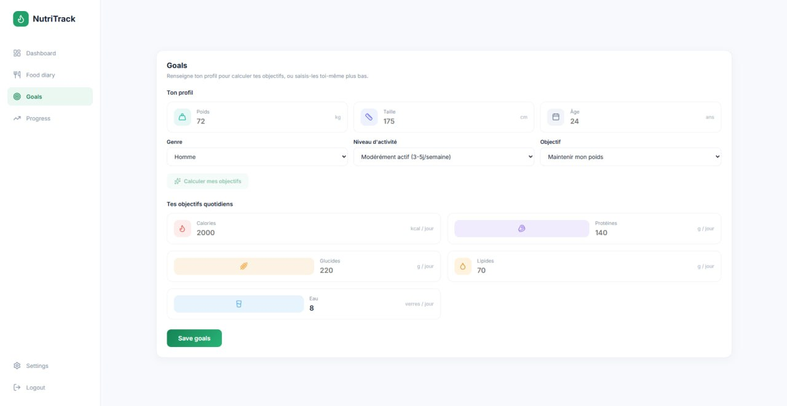
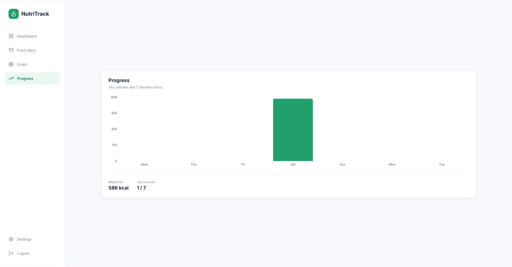
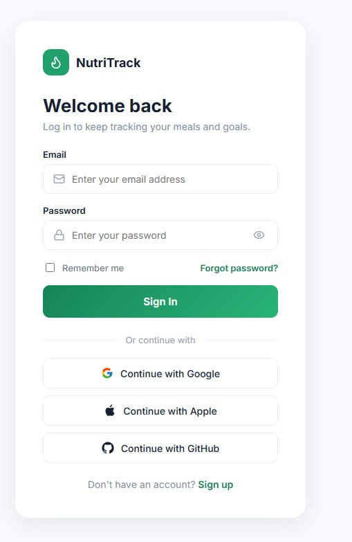

# 🥗 NutriTrack

Application web de suivi calorique : enregistre tes repas, suis tes calories et macros, et atteins tes objectifs au quotidien.

🔗 **[Live demo](https://calorie-tracker-phi-nine.vercel.app)**

**Stack :** Laravel (API) · React + Vite
**Déploiement :** Railway (backend) · Vercel (frontend)

---

## 📸 Aperçu

| Dashboard | Food diary |
|---|---|
|  |  |

| Goals | Progress |
|---|---|
|  |  |

<details>
<summary>Page de connexion</summary>



</details>

---

## ✨ Fonctionnalités

- **Authentification** : connexion et inscription par email
- **Dashboard** : calories du jour, protéines, glucides, suivi de l'eau (verres) et conseil quotidien
- **Food diary** : repas par catégorie (petit-déjeuner, déjeuner, dîner, snack) avec navigation par jour
- **Goals** : calcul automatique des objectifs (calories, protéines, glucides, lipides, eau) à partir du profil (poids, taille, âge, genre, niveau d'activité, objectif), ou saisie manuelle
- **Progress** : graphique des calories sur les 7 derniers jours, moyenne et nombre de jours suivis

---

## 🗂️ Structure du projet

```
calorie-tracker/
├── backend/    # API Laravel
└── frontend/   # Application React (Vite)
```

---

## 🚀 Installation en local

### Prérequis

- PHP 8.1+ et Composer
- Node.js 18+ et npm
- Une base de données (configurée dans le `.env` du backend)

### Backend

```bash
cd backend
composer install
cp .env.example .env
php artisan key:generate
# Configure la base de données dans .env, puis :
php artisan migrate
php artisan serve
```

### Frontend

```bash
cd frontend
npm install
npm run dev
```

Pense à renseigner l'URL de l'API backend dans le fichier `.env` du frontend.

---

## 🌍 Déploiement

- **Backend** : Railway
- **Frontend** : Vercel

---

## 👤 Auteur

**Hamza**
Développeur full-stack (Laravel, React, FastAPI)
